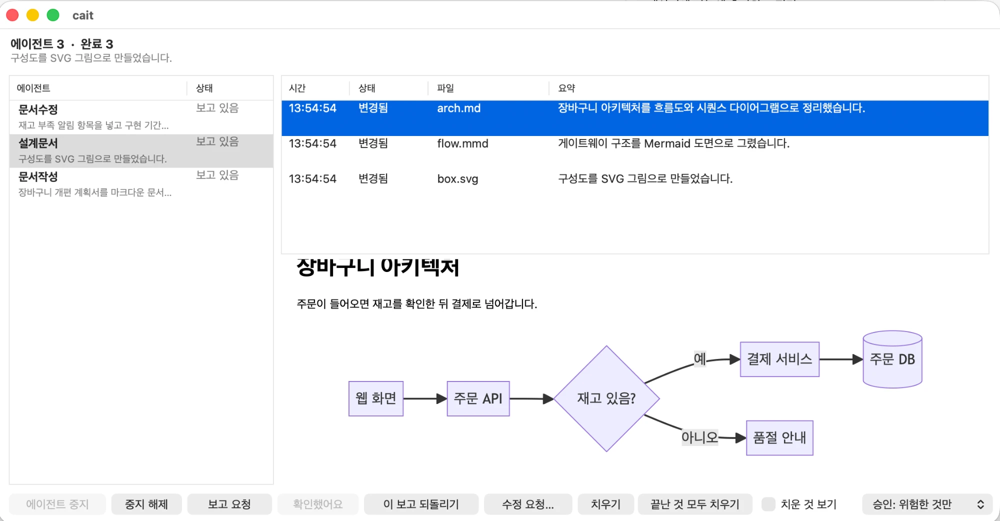

# cait

서브에이전트가 한 일을 **검증**하도록 돕는 macOS용 도구입니다. (cat + AI)



## 왜 만들었나

서브에이전트에게 일을 나눠 맡기면 빨라지지만, 사용자는 "무엇을 바꿨는지, 시킨 대로 했는지, 위험한 일은 하지 않았는지"를 확인하기 어렵습니다. 결과만 믿고 넘기거나, 로그를 일일이 열어 봐야 합니다.

cait는 그 검증을 쉽게 만듭니다.

- **무엇을 바꿨는지 바로 본다:** 서브에이전트가 파일을 고칠 때마다 쉬운 말로 된 요약이 화면에 올라옵니다. 변경량(+N −M)은 에이전트의 말이 아니라 cait가 git으로 직접 잽니다.
- **빠진 것을 잡는다:** 끝났는데 완료 보고가 없거나, 마지막 보고 뒤에 몰래 고친 파일이 있으면 "확인 필요"로 표시합니다.
- **문서와 도면을 읽는다:** 에이전트가 쓴 마크다운(바뀐 줄은 색으로 표시)과 Mermaid 아키텍처 도면을 그 자리에서 봅니다.
- **그 자리에서 조치한다:** 이상하면 중지하고, 한 건씩 되돌리고, 메인 에이전트에게 수정이나 보고를 요청합니다. 위험한 명령(`rm -rf`, `git push` 등)은 사용자가 화면에서 허용해야 실행됩니다.

파일을 많이 바꾸는 작업은 알림이 넘칠 수 있어서 **메인 에이전트가 보고 단위를 조절**합니다.

## 지원 환경

- **macOS 전용**입니다. 창(`cait gui`)이 Cocoa로 되어 있고, 터미널 화면(`cait panel`)과 명령도 macOS 기준으로 만들고 시험했습니다.
- 서브에이전트 연동은 **Claude Code**의 스킬과 훅을 씁니다. 훅이 없어도 보고를 받고 보는 것은 됩니다.
- 다이어그램을 그릴 때만 인터넷이 필요합니다.

## 빠른 시작

```bash
git clone https://github.com/Eunryong/cait.git && cd cait
make                 # 빌드
make test            # 테스트 (선택)
export CAIT="$PWD/cait"
./cait gui           # 창 띄우기
```

Claude Code에서 쓰려면 아래 둘을 연결합니다. 스킬과 훅은 모두 `${CAIT:-cait}`로 cait를 부르므로, **환경변수 `CAIT`에 실행 파일 경로를 주입**하면 어느 위치에 설치해도 됩니다.

1. **스킬:** [cait-report](.claude/skills/cait-report/SKILL.md)(서브에이전트용), [cait-level](.claude/skills/cait-level/SKILL.md)(메인 에이전트용)을 프로젝트나 `~/.claude/skills`에 둡니다.
2. **훅:** [.claude/settings.json](.claude/settings.json)의 `hooks`를 설정에 합칩니다. 도구 호출 직전(`PreToolUse`), 허락 요청(`PermissionRequest`), 서브에이전트 종료(`SubagentStop`)에 `cait check`를 연결합니다. 진행 상황, 되돌리기, 승인, 강제 중단은 이 훅이 있어야 동작합니다.
3. **경로 주입:** Claude Code 설정(`.claude/settings.local.json` 또는 `~/.claude/settings.json`)의 `env`에 넣거나 셸 프로필에서 내보냅니다.

```json
{ "env": { "CAIT": "/절대/경로/cait" } }
```

`cait`를 `PATH`에 두면 `CAIT` 없이도 됩니다.

메인 에이전트는 `cait-level` 스킬로 보고 단위를 정하고, 서브에이전트를 띄울 때 `cait-report` 스킬을 쓰라고 지시합니다. 서브에이전트는 파일을 고칠 때마다 `cait report`를 부르고, 일을 끝내면 `--final`로 마무리합니다.

## 화면 사용법

왼쪽에는 에이전트 목록, 오른쪽에는 고른 에이전트의 보고(시간, 상태, 파일, 요약)가 나옵니다. 위쪽에는 상태별 개수와, 고른 에이전트에게 무엇을 시켰는지가 한 줄로 나옵니다.

### 에이전트 상태

목록은 **지금 봐야 할 것이 위로** 올라오게 정렬됩니다. 각 행의 둘째 줄은 지금 하는 일을 말로 풀어 보여 줍니다("수정 중: cart.c", "명령 실행 중: …").

| 상태 | 뜻 | 할 일 |
| --- | --- | --- |
| ⚠ 승인 대기 (빨강) | 에이전트가 위험한 작업의 허락을 기다림 | 에이전트를 고르면 위에 뜨는 노란 줄에서 **허용 / 거부** |
| 확인 필요 (주황) | 끝났는데 완료 보고가 없거나, 마지막 보고 뒤에 고친 파일이 있음 | **보고 요청** 또는 **확인했어요** |
| 보고 요청 중 | 보고를 요청했고 에이전트의 답을 기다림 | 기다리면 보고가 올라옴 |
| 중단됨 (빨강) | 중단 요청이 걸려 있음 | 필요하면 **중지 해제** |
| 진행 중 (초록) / 잠시 멈춤 (주황) | 일하는 중 / 20초 넘게 도구 호출이 없음 | 오래 멈춰 있으면 중지를 고려 |
| 완료 | 완료 보고가 도착함 (사용자가 확인한 것은 "확인함") | **치우기** |

확인할 것이 있으면 Dock 아이콘에 개수가 붙고 창 제목에도 나옵니다. 사용자가 이미 본 항목은 센 개수에서 빠지고, 그 에이전트가 더 일하면 다시 셉니다.

### 버튼

버튼은 고른 항목에서 할 수 있는 것만 켜지고, 마우스를 올리면 설명이 나옵니다.

| 버튼 | 하는 일 |
| --- | --- |
| 에이전트 중지 / 중지 해제 | 고른 에이전트의 중단 요청을 걸거나 풉니다 (`cait stop`과 같은 파일에 기록) |
| 보고 요청 | 보고가 빠진 에이전트에게 보고를 시키도록 메인 에이전트에게 전달합니다. 누르면 버튼이 "요청 진행 중…"으로 바뀝니다 |
| 확인했어요 | 결과를 직접 확인했다고 표시합니다. 그 에이전트가 더 일하기 전까지 "확인 필요"에서 빠집니다 |
| 이 보고 되돌리기 | 고른 보고의 파일 변경을 그 보고 직전 상태로 되돌립니다 |
| 수정 요청… | 고칠 점을 적어 메인 에이전트에게 보냅니다. 메인 에이전트가 해당 서브에이전트를 멈추거나 다시 지시합니다 |
| 치우기 / 끝난 것 모두 치우기 | 끝난 에이전트를 목록에서 치웁니다. 보고 기록은 남습니다 |
| 치운 것 보기 | 치운 에이전트도 목록에 다시 표시합니다 |
| 승인: 위험한 것만 / 전부 묻기 / 끄기 | 서브에이전트 호출을 어떻게 승인받을지 정합니다 |

### 문서와 도면 미리보기

보고에 문서 파일이 들어 있으면, 보고를 골랐을 때 보고 목록 아래에 내용이 나옵니다.

- **마크다운(`.md`):** 제목, 목록, 코드, 인용, 표가 읽기 좋은 모양으로 나옵니다. **이번 보고에서 바뀐 줄은 초록색 배경**으로 칠합니다. 비교 기준은 에이전트가 고치기 직전 내용이고, 새로 만든 파일은 칠하지 않습니다.
- **아키텍처 도면:** 마크다운 안의 ` ```mermaid ` 블록과 `.mmd` 파일은 흐름도, 시퀀스 다이어그램 등으로 그려집니다. 그림 파일(`.png` `.jpg` `.gif` `.svg` `.webp`)은 그대로 보입니다. 다이어그램을 그리려면 인터넷 연결이 필요하고, 연결이 없으면 원본 텍스트를 보여 줍니다. 다이어그램이 든 문서에는 바뀐 줄 색칠이 없습니다.

### 단축키

창에서 `⌘W`는 창 닫기(창이 하나라 곧 종료), `⌘Q`는 종료, `⌘M`은 최소화, `⌘H`는 숨기기입니다.

### 터미널 패널

`cait panel`은 같은 정보를 터미널에서 보여 줍니다. `↑↓` 선택, `s` 선택한 에이전트 중단, `c` 해제, `k` 확인함, `x` 치우기, `X` 끝난 것 모두 치우기, `h` 치운 것 보기, 승인 요청이 있으면 `y` 허용·`n` 거부, `q` 종료.

## 명령

| 명령 | 누가 | 하는 일 |
| --- | --- | --- |
| `cait report [--agent 이름] --file 경로 [--file 경로 ...] "요약"` | 서브에이전트 | 바꾼 파일(들)과 요약을 보낸다. 파일마다 한 번, 또는 관련 파일을 묶어서 한 번 |
| `cait report --agent 이름 --final "요약"` | 서브에이전트 | 일을 모두 끝내며 보내는 마지막 보고. 파일은 필요 없다 |
| `cait level [files\|group]` | 메인 에이전트 | 보고 단위를 정한다. 인자 없이 쓰면 현재 값 |
| `cait log [--json] [--agent 이름] [--last N]` | 메인 에이전트, 패널 | 지금까지의 보고를 읽는다. `--json`은 한 줄에 객체 하나 |
| `cait status [--json] [--all]` | 사용자, 메인 에이전트 | 에이전트마다 상태, 보고 수, 도구 호출 수, 마지막으로 한 일, 시킨 일, 마지막 보고, 완료 보고 도착 여부, 보고 안 한 수정 횟수 |
| `cait watch [--notify] [--once]` | 사용자 | 터미널에서 보고를 실시간으로 본다. `--notify`는 macOS 알림도 띄운다 |
| `cait gui` / `cait panel` | 사용자 | 창(macOS) / 터미널 전체 화면 |
| `cait stop [--agent 이름] [이유]` / `--clear` | 메인 에이전트 | 중단 요청을 건다. `--agent`를 생략하면 전체 |
| `cait revert --id ID [--dry-run]` | 화면, 메인 에이전트 | 보고 한 건의 변경을 되돌린다 |
| `cait tell [--agent 이름] "요청"` / `cait inbox` | 화면, 메인 에이전트 | 사용자의 수정 요청을 메인 에이전트에게 보낸다 |
| `cait brief [--agent 이름]` | 화면, 메인 에이전트 | 메인 에이전트가 그 서브에이전트에게 시킨 일을 보여 준다 |
| `cait ack --agent 이름` | 사용자 | 끝난 에이전트를 "확인함"으로 표시한다 |
| `cait forget --agent 이름 \| --done \| --undo` | 사용자 | 끝난 에이전트를 목록에서 치우거나 되살린다. 기록은 남는다 |
| `cait perm [--json]` / `allow ID` / `deny ID [사유]` | 화면, 사용자 | 에이전트의 승인 요청을 보거나 답한다 |
| `cait guard [add 문구 \| mode on\|all\|off]` | 사용자 | 승인이 필요한 문구 목록과 승인 방식을 본다 |

서브에이전트의 최종 답변은 메인 에이전트가 사용자에게 전달하므로 cait로 따로 보내지 않습니다. cait는 작업 중의 파일 변경 요약을 다룹니다.

### 보고 단위

| level | 사용자에게 보이는 단위 |
| --- | --- |
| `files` (기본) | 파일마다 한 건 |
| `group` | 관련 파일을 묶어 한 건 (파일 목록과 합산 변경량 포함) |

메인 에이전트가 `group`으로 바꾸면 에이전트들이 "기능/영역 단위"로 묶어 보고합니다. 개수는 줄지만 변경과 요약은 사라지지 않습니다. 서브에이전트는 첫 보고 전에 `cait level`로 단위를 읽고 따릅니다.

### 보고 예시

```
19:04:09  booking-fix  업데이트됨 src/booking/create.c  +3 −1
            예약을 만들 때 중복 요청을 확인하는 기준을 예약 상태가 아니라 요청 키로 바꿨습니다
19:04:12  login        3개 파일  +86 −12
            auth/login.c
            auth/token.c
            auth/session.c
            로그인 검사가 만료된 토큰도 거부하고 세션을 새로 만들도록 바꿨습니다
```

`--file`로 보고하면 cait가 git으로 상태(생성/업데이트/삭제)와 `+N −M`을 직접 측정해 함께 저장합니다. 에이전트는 요약만 적습니다. 수치는 HEAD 기준 현재 변경분이라 같은 파일을 여러 번 보고하면 누적된 값입니다. git 저장소가 아니면 수치 없이 요약만 나옵니다.

## 동작 방식

### 진행 상황
훅이 서브에이전트의 도구 호출마다 마지막 도구와 대상, 호출 수를 기록하고 `SubagentStop` 훅이 끝남을 표시합니다. `cait status`와 화면은 이것과 보고를 합쳐 1초마다 다시 읽습니다. 실시간의 단위는 도구 호출이라서, 한 번의 호출이 길게 걸리면 그 사이에는 "잠시 멈춤"으로 보입니다. 첫 보고 전의 에이전트는 이름 대신 id 앞 8자로 나옵니다. 훅이 없으면 보고가 있는 에이전트만 나옵니다.

### 서브에이전트에게 시킨 일
훅은 메인 에이전트가 서브에이전트를 띄울 때(`Agent` 도구) 설명과 프롬프트를 보관하고, 그 서브에이전트가 처음 `cait report --agent 이름`을 부를 때 이름이 프롬프트에 든 것과 짝지어 `cait brief`로 보여 줍니다. 그래서 스킬은 `description`을 사용자가 읽을 한 문장으로 쓰고 프롬프트에 `--agent` 이름을 적으라고 지시합니다.

### 끝난 뒤 확인: 완료 보고와 보고 안 한 수정
에이전트가 끝났을 때 "확인 필요"가 되는 경우는 두 가지입니다. `cait report --final`이 오지 않았거나, 마지막 보고 뒤에 훅이 센 `Edit`·`Write` 호출이 있는 경우입니다. 보고도 수정도 없이 읽기만 한 에이전트는 해당되지 않습니다. Bash로 한 수정은 세지 못합니다. 보고는 에이전트가 따라 줘야 하므로 "없음"은 "에이전트가 안 보냈다"는 뜻이지 "일을 안 했다"는 뜻이 아닙니다. 확인했어요를 누르면 그 에이전트가 더 일하기 전까지 확인 필요에서 빠집니다.

### 보고 단위로 되돌리기
`cait report`는 보고하는 순간 파일의 내용을 `~/.cait/snap`에 보관합니다. 훅이 Edit/Write 직전에 파일을 따로 보관하므로, `cait revert`는 그 보고에 담긴 첫 편집 직전의 내용으로 정확히 돌아갑니다(없던 파일은 지웁니다). git이 없어도 됩니다. 훅이 못 본 경우(Bash로 고친 파일 등)에는 같은 파일에 대한 앞선 보고 직후의 내용, 그것도 없으면 마지막 커밋의 내용으로 돌아갑니다. 같은 파일을 이후 보고가 또 고쳤다면 그 변경도 함께 사라지며, 되돌리기 전에 그 내용을 알려 줍니다. 되돌리기 전 파일은 `~/.cait/undo`에 백업되고 피드에 "되돌림" 기록이 남습니다. 기준이 없으면 되돌리지 않고, 1MB를 넘는 파일은 보관하지 않습니다.

### 수정 요청과 보고 요청
화면에서 보낸 요청은 `cait tell`로 `~/.cait/inbox.tsv`에 쌓입니다. `PreToolUse` 훅이 **메인 에이전트의 다음 도구 호출**에 그 내용을 붙여 주고, 메인 에이전트는 서브에이전트를 멈추거나 다시 지시합니다. 메인 에이전트가 도구를 호출하기 전에는 전달되지 않습니다. 서브에이전트가 사용자인 척 요청을 넣지 못하도록 훅이 서브에이전트의 `cait tell`을 막지만, 파일을 직접 쓰는 우회까지 완전히 막지는 못합니다.

### 보고를 보고 바로 멈추기
`cait stop`을 하면 해당 서브에이전트가 **다음 `cait report`를 호출할 때** `STOP: ...`을 받고 종료 코드 3으로 끝납니다. 스킬이 이 메시지를 받으면 즉시 멈추라고 지시합니다. 보고 없이 오래 걸리는 작업 중에는 멈추지 않으며, 이미 쓴 변경은 되돌리지 않습니다. 중단 요청은 해제할 때까지 남습니다.

훅이 있으면 더 확실하게 막을 수 있습니다. 전체 중단(`--agent` 없이)이 걸려 있으면 **서브에이전트의** 도구 호출을 거부하고, `--agent 이름`은 그 이름의 에이전트만 막습니다. 메인 에이전트와 `cait` 명령은 막지 않습니다.

### 허락 요청을 화면에서 처리 (Claude Code 전용)
`PermissionRequest` 훅은 Claude Code가 사용자에게 허락을 묻기 직전에 그 질문을 화면에 올리고 최대 40초(`CAIT_PERM_WAIT`) 기다립니다. 누른 답이 훅을 통해 그대로 돌아가고, 답이 없으면 원래 확인창이 뜹니다. 이 훅은 Claude Code가 실제로 확인창을 띄울 때만 불리며, 서브에이전트의 허락 요청에도 불리는지는 Claude Code 문서에 명시되어 있지 않습니다.

### 위험한 호출은 화면에서 승인받기 (가드, Claude Code 전용)
권한 모드가 `auto`처럼 확인 없이 통과시키면 위 훅이 불리지 않습니다. 그래서 cait는 서브에이전트의 도구 호출 직전에도 호출 내용을 검사합니다. 명령이나 파일 경로에 `rm -rf`, `git push`, `curl `, `sudo ` 같은 문구가 있으면 호출을 멈추고 해당 에이전트 행에 ⚠를 띄우며, 창에서 허용하면 진행하고 거부하거나 120초(`CAIT_GUARD_WAIT`) 안에 답이 없으면 막습니다. 에이전트에게는 사유와 "다시 시도하지 말라"는 메시지가 갑니다. 문구 목록은 `cait guard`로 보고 `cait guard add 문구`로 늘립니다(`~/.cait/guard`). 서브에이전트가 스스로 승인하지 못하도록 훅이 서브에이전트의 `cait perm`, `perm/` 접근을 막습니다.

`cait guard mode on|all|off`로 범위를 정합니다. `on`(기본)은 위험한 문구가 든 호출만, `all`은 서브에이전트의 모든 명령과 파일 편집을, `off`는 아무것도 묻지 않습니다. 창 아래쪽 "승인:" 메뉴로도 바꾸며, 메인 에이전트의 호출은 검사하지 않습니다. 문구 포함 검사라 우회될 수 있어서 방어선이 아니라 확인 장치입니다.

### 끝난 에이전트 치우기, 기록은 남기기
`cait forget --agent 이름`, `--done`은 끝난 에이전트를 목록에서만 치웁니다. 실행 중인 에이전트는 치워지지 않습니다. 보고는 `feed.tsv`에 그대로 남아 `cait log`와 보고 표에서 계속 볼 수 있고 되돌리기도 됩니다. 치운 에이전트는 `cait status --all`, 창의 "치운 것 보기", 패널의 `h`로 다시 보이고, `cait forget --undo`로 모두 되살립니다. 다시 일하기 시작한 에이전트는 목록에 저절로 돌아옵니다.

### 보여주는 방식은 cait의 일이 아니다
cait는 보고를 파일(`feed.tsv`)에 쌓기만 합니다. 어떻게 보여 줄지는 `cait log --json`을 읽는 쪽이 정합니다. 창과 패널은 그중 하나입니다.

## 저장 위치

기본은 `~/.cait`이고 `$CAIT_DIR`로 바꿀 수 있습니다. 현재 디렉터리와 무관하므로 서브에이전트가 `cd`해도 같은 피드에 쓰이고 프로젝트 폴더에 파일이 생기지 않습니다. 대신 한 사용자의 모든 세션이 피드와 설정을 공유합니다.

| 파일 | 내용 |
| --- | --- |
| `feed.tsv` | 보고 (시각, 에이전트, 파일, 상태, 추가/삭제 줄, 요약) |
| `level` | 보고 단위 |
| `snap/`, `undo/` | 되돌리기용 파일 보관과 백업 |
| `act/`, `agents`, `brief/` | 에이전트별 진행 기록, id와 이름 짝, 시킨 일 |
| `stop`, `inbox.tsv`, `perm/` | 중단 요청, 수정 요청, 승인 요청 |
| `guard`, `guardmode`, `hidden`, `ack` | 승인 문구와 방식, 치운 에이전트, 확인한 에이전트 |

## 소스 구성

| 파일 | 역할 |
| --- | --- |
| `src/main.c` | 명령 분배 |
| `src/report.c` | `report`, `level` (서브에이전트가 피드에 쓰는 쪽) |
| `src/watch.c` | `watch`, `log` (피드를 읽는 쪽) |
| `src/status.c` | 에이전트별 진행 기록, `status`, `ack`, `forget` |
| `src/check.c` | 훅 진입점 `check` (진행 기록, 중단, 가드, 요청 전달, 스냅샷) |
| `src/guard.c`, `src/perm.c` | 위험한 호출의 승인 문구와 승인 요청·응답 |
| `src/revert.c` | 보고 id, 스냅샷, 되돌리기 |
| `src/stop.c`, `src/tell.c`, `src/agents.c` | 중단 요청, 사용자 요청 전달, 에이전트 신원과 시킨 일 |
| `src/measure.c`, `src/util.c` | git 변경량 측정, 경로·JSON·파일 도구 |
| `src/panel.c` | 터미널 전체 화면 |
| `src/gui.m`, `src/gui_markdown.m` | 창, 마크다운 렌더링과 도면 페이지 (Objective-C) |
| `tests/run.sh` | 실제 바이너리를 임시 폴더와 git 저장소에서 돌리는 테스트 |

`make test`는 보고·로그·단계 조절·중단·되돌리기·완료 보고·확인·치우기·가드(허용/거부/시간 초과)·서브에이전트의 자기 승인 차단·요청 전달을 검사합니다. CI는 GitHub Actions(macOS)에서 같은 명령을 돌립니다. 창과 마크다운 미리보기는 자동 테스트 대상이 아닙니다.

## 왜 C인가
- 여러 서브에이전트가 동시에 보고해도 줄 단위로 안전하게 쓰고(`flock`) 바로 확인할 수 있습니다.
- 서브에이전트가 도구를 호출할 때마다 훅 프로세스가 새로 뜨므로 시작이 빠를수록 작업 속도에 영향이 적습니다.

## 이후
- 같은 파일에 대한 연속 보고 합치기
- 다이어그램이 든 문서의 바뀐 부분 표시
